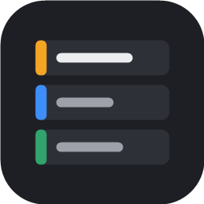
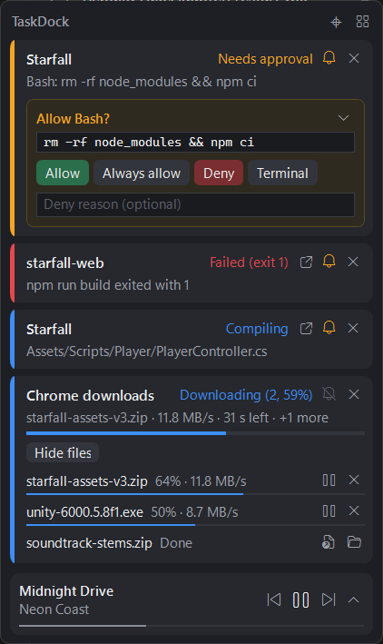
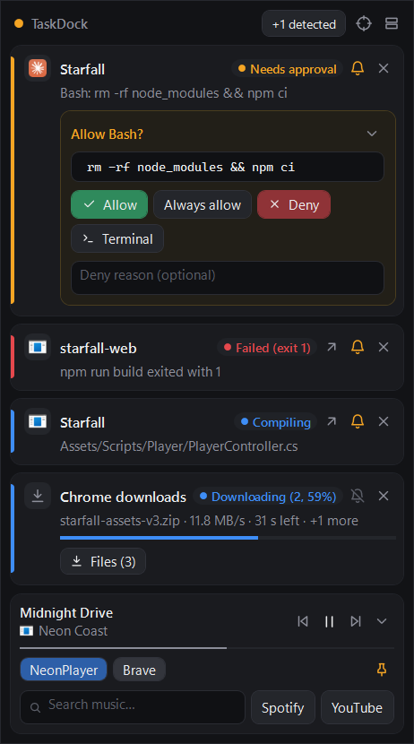
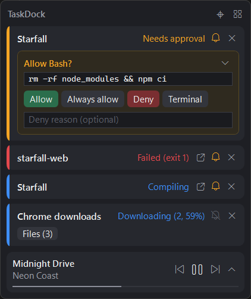
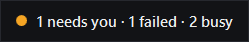
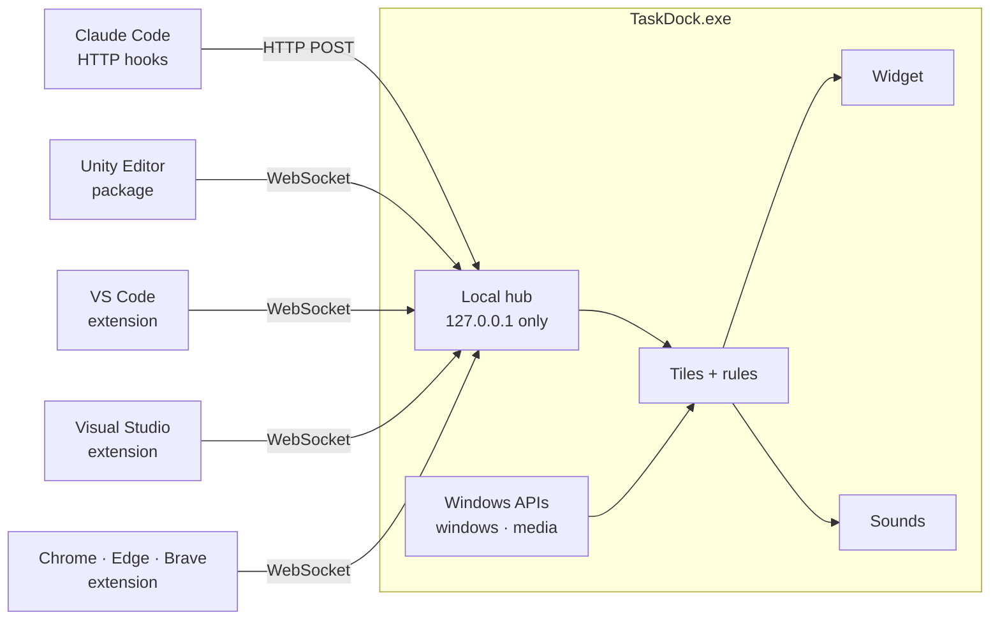

<p align="center">
  
</p>

<h1 align="center">TaskDock</h1>

<p align="center">
  <b>Everything your PC is working on, in one quiet corner of the screen.</b><br>
  An always-on-top Windows widget for Claude Code, Unity, Visual Studio, VS Code, browser downloads and whatever is playing.<br>
  It tells you when something is done, when something failed, and when something is waiting for you.
</p>

<p align="center">
  <a href="https://github.com/AniketRaut02/TaskDock/releases/latest"></a>
  
  
  <a href="LICENSE"></a>
</p>

<p align="center">
  <a href="#install">Install</a> ·
  <a href="#connect-your-tools">Connect your tools</a> ·
  <a href="#features">Features</a> ·
  <a href="#using-taskdock">Using TaskDock</a> ·
  <a href="#how-it-works">How it works</a> ·
  <a href="#faq">FAQ</a>
</p>

<p align="center">
  
</p>

---

## Why TaskDock

Modern work is a lot of waiting. Waiting for an AI agent to finish a turn or ask permission, for Unity to compile and reload, for a build to fail, for a 2 GB download. You end up checking five windows.

TaskDock watches them for you and sits in a screen corner without ever taking focus:

- **See everything at a glance.** One tile per source, colour-coded. The things that need you float to the top.
- **Act without switching.** Approve or deny a Claude Code tool call, start Unity's play mode, pause a download, or skip a track, right from the tile.
- **Hear only what matters.** You choose per tile which ones make a sound. Each finished job gets one sound, never a stream of them.

## Install

### The app: one line

Open **PowerShell** and run:

```powershell
irm https://raw.githubusercontent.com/AniketRaut02/TaskDock/master/install.ps1 | iex
```

This installs the latest release for your user (no admin rights) and starts it:

- `TaskDock.exe` goes to `%LOCALAPPDATA%\Programs\TaskDock`, with a Start menu shortcut.
- The browser extension is unpacked next to it, ready for **Load unpacked**.
- If Visual Studio 2022 or 2026 is installed, the installer offers to add the Visual Studio extension. Visual Studio's own installer window finishes it.
- If VS Code's `code` command is available, the installer offers to add the VS Code extension too.

Run the same line again to upgrade. Your settings, presets and connections are kept.

> **First run:** the build isn't code-signed yet, so Windows SmartScreen may say it "protected your PC". Click **More info → Run anyway**.

Prefer a manual install? Every file is on the [Releases page](https://github.com/AniketRaut02/TaskDock/releases/latest).

## Connect your tools

Each integration is optional, and each takes about a minute.

| Tool | Setup |
|---|---|
| **Claude Code** | Right-click the TaskDock tray icon → **Connect Claude Code**. Done. New sessions appear in the widget. |
| **Unity** (2022.3+) | **Window → Package Manager → + → Add package from git URL**, then paste:<br>`https://github.com/AniketRaut02/TaskDock.git?path=/adapters/unity/com.darkpixelgd.taskdock`<br>Needs [Git](https://git-scm.com/download/win) installed. |
| **Visual Studio** (2022, 2026) | Accept the installer's offer, or download `taskdock-visualstudio-0.1.0.vsix` from [Releases](https://github.com/AniketRaut02/TaskDock/releases/latest) and double-click it. Close Visual Studio first; it connects the next time you open it. |
| **VS Code** (1.93+) | Accept the installer's offer, or download `taskdock-0.1.0.vsix` from [Releases](https://github.com/AniketRaut02/TaskDock/releases/latest) → Extensions view → **…** → **Install from VSIX…** |
| **Chrome, Edge, Brave** | Open `chrome://extensions` (or `edge://extensions`, `brave://extensions`) → turn on **Developer mode** → **Load unpacked** → pick `%LOCALAPPDATA%\Programs\TaskDock\browser-extension` |
| **Spotify, YouTube, any player** | Nothing to set up. The media bar uses Windows' own media controls. |
| **Any other app** | Drag the **⌖** button from the widget's header onto the app's window, or drop a shortcut or `.exe` on the widget. |

New sources never add themselves. They wait under **+N detected** in the header (the tray icon shows the count) until you pin them.

## Use TaskDock from your phone

TaskDock Remote puts the widget on an Android phone: live tiles, approvals, Unity controls, downloads, presets and the media bar, at home or away. It runs over your own [Tailscale](https://tailscale.com) network. There's no TaskDock server and no account.

**Set up once (about 10 minutes):**

1. Install Tailscale on the PC and on the phone, and sign in to both with the same account.
2. In the Tailscale admin console under **DNS**, turn on **MagicDNS** and **HTTPS Certificates**.
3. Tray icon → **Phone (Remote)…**. Follow the checklist, then tick **Let my paired phones reach TaskDock**.
4. Click **Pair a phone…**, scan the QR code with the phone and open it in Chrome. Confirm with your fingerprint, then click **Allow** on the PC.
5. On the phone: Chrome menu → **Add to Home screen**. Then **⋯ → Turn on alerts** (notifications must be on for Chrome in Android settings).

**What you can do from the phone:**

- See every tile live, in the widget's order and colours.
- Answer Claude Code approvals: read-only tools with one tap, anything that can change files with your fingerprint. A diff shows what an edit would change.
- Play, pause and stop Unity; pause, resume and cancel downloads; pin, rename and launch tiles; apply presets; control the media bar.
- **Peek** at a tile's window (fingerprint once per 5 minutes), **Lock** the PC, or put it to **Sleep**.
- See everything a phone did under **Activity**, on the phone and in the Phone (Remote) window.

**While you're away** (no keyboard or mouse for 3 minutes, adjustable):

- Approvals and failures reach the locked phone as notifications. **Deny** works straight from the notification.
- Approvals wait up to 10 minutes for you instead of 2. Restart Claude Code sessions that were running when you turned Remote on, so they pick up the longer wait.
- The PC stays awake while work is running, then sleeps on its normal schedule.

**Limits:** Android with Chrome only (an iPhone may work but isn't tested). A sleeping PC can't be woken from the phone. A Claude **Needs input** can't be answered remotely. Focus, Open and Show in folder stay on the PC. Your PC's Tailscale name becomes public in certificate transparency logs, as every HTTPS name does. Tailscale's free Personal plan is for non-commercial use.

## Features

### Integrations

| | What you see | What you can do from the tile |
|---|---|---|
| **Claude Code** | Working · Needs approval · Needs input · Done · Failed, plus the tool it's running and how many subagents | **Allow**, **Always allow**, **Deny** with a reason Claude reads, or hand the decision back to the **Terminal** |
| **Unity Editor** | Compiling · Reloading · Importing · Playing · Paused · Building · Compile errors (n) · Background task (%) · Main thread blocked · Not responding | **▶ Play**, **Pause**, **■ Stop**, **Focus** |
| **Visual Studio** | Building · Build succeeded · Build failed (n of m projects) · Debugging · **Paused** at a breakpoint or exception · Not responding | **Focus** |
| **VS Code** | Task running · Debugging · Command running (terminal commands longer than 10 s) · Succeeded · Failed (exit code) | **Focus** |
| **Browser downloads** | Downloading (count, %, speed, time left) · Needs confirmation · Complete · Failed · Paused | **Pause**, **Resume**, **Cancel**, **Open**, **Show in folder** per file |
| **Media bar** | Title, artist, cover art and progress of whatever Windows says is playing | Previous / play-pause / next, switch between players, pin one player, search Spotify or YouTube |
| **Any window** | Running · Not responding · Closed, with the window title | **Focus**, **Launch** when it's closed |

<p align="center">
  
</p>

### Three sizes

Press **Ctrl+Alt+Shift+D** (or the button in the header) to cycle between them:

<table>
  <tr>
    <td align="center" valign="top"><br><b>Expanded</b><br>Details, progress and actions</td>
    <td align="center" valign="top"><br><b>Compact</b><br>One line per tile</td>
    <td align="center" valign="top"><br><b>Pill</b><br>One dot in the worst colour, with counts</td>
  </tr>
</table>

### Built to stay out of the way

- **Never steals focus.** Clicking a tile doesn't pull you out of Unity or your editor. It's hidden from the taskbar and Alt-Tab.
- **Snaps to a corner** of whichever monitor you drop it on, and grows toward the middle of the screen.
- **Hides itself** while a game, presentation or fullscreen video is showing.
- **Light:** about 32 MB of memory at idle and under 1% CPU with eight busy tiles.

## Using TaskDock

### Status colours

| Colour | Meaning | Examples |
|---|---|---|
| 🟧 Amber | Waiting on you | Claude needs approval or input, a download needs confirmation |
| 🟥 Red | Failed | Build exited with 1, compile errors, download interrupted, app not responding |
| 🟦 Blue | Working | Compiling, downloading, Claude working, task running |
| 🟩 Green | Finished since you last looked | Claude's turn done, download complete, task succeeded |
| ⬜ Grey | Idle or offline | Ready, or not running |

Amber and red tiles float to the top. A green tile turns grey once you hover over it.

Each tile shows the icon of the app it comes from (Unity, Visual Studio, your browser…), so two tiles with the same project name are easy to tell apart. The media bar shows the playing app's icon too; YouTube shows your browser's icon, since that's where it plays.

### Pin, notify, arrange

- **Pin** a detected source with its pin button. A pinned tile remembers its project, folder or app, so it comes back when you reopen that project tomorrow, even though the session ID changes.
- **The bell** on a pinned tile turns on sounds: one each for done, needs-you and failed. Sounds collapse to at most one per second. Drop your own `Complete.wav`, `Attention.wav` or `Error.wav` into `%APPDATA%\TaskDock\sounds` to replace them.
- **Right-click a tile** for Rename, Focus, Launch and Remove.
- **Drag the header** to move the widget. It snaps to the nearest corner.

### Presets

A preset saves your pinned tiles, their sounds, the corner and the size. Right-click the tray icon → **Presets**:

- **Save current as…** saves the layout, with the command that launches each source.
- Click a preset to **switch** to it. **Shift+click** merges it into what you have.
- **Launch missing** starts every pinned source that isn't running, two seconds apart. For example, open your Unity project, its VS Code workspace and Claude Code in its folder with one click.

### Settings

Right-click the tray icon → **Settings…** for mute, volume, quiet hours, staying silent while you're looking at the source, hiding during fullscreen, **Start with Windows**, how long an approval waits in the widget before the terminal takes over, and the terminal command Claude tiles launch with.

## How it works



Every source reports to a small server inside TaskDock that only listens on your own machine. Claude Code needs no code of ours at all: TaskDock adds a few HTTP hooks to `~/.claude/settings.json`, after backing the file up. An approval works by holding Claude's permission request open until you click a button.

### Privacy and security

- **Nothing leaves your PC unless you turn on Remote.** No telemetry, no accounts. With Remote on, your paired phones reach TaskDock over your own Tailscale network, and notifications go through Google's push service end-to-end encrypted: Google sees when and to which phone, not what they say.
- **Only you can approve.** Approve and Deny are buttons in the widget, or on a phone you paired yourself. A phone needs to be on your tailnet, signed in as you, hold its own token, and, for anything that can change files, sign that exact request with its fingerprint passkey. Notifications never contain the command, a path or a file name.
- **Locked to your machine.** The hub binds to `127.0.0.1`, needs a per-user token, rejects foreign `Host` headers (DNS rebinding) and never answers cross-origin requests. Browsers are accepted only from TaskDock's own extension.
- **Downloads stay private.** The browser extension reports file names, sizes and progress, never URLs.
- **Logs don't hold your work.** Prompts and tool inputs are never logged.

## Requirements

- Windows 10 (2004 or later) or Windows 11, 64-bit
- Optional: Claude Code with HTTP hooks, Unity 2022.3 or 6, Visual Studio 2022 or 2026, VS Code 1.93+, Chrome / Edge / Brave 116+

## Build from source

You need the [.NET 10 SDK](https://dotnet.microsoft.com/download) and [Node.js 22+](https://nodejs.org).

```powershell
git clone https://github.com/AniketRaut02/TaskDock.git
cd TaskDock
powershell -ExecutionPolicy Bypass -File tools/release.ps1
```

This runs every test, then builds all release files into `artifacts/release`. The Visual Studio extension is built with Visual Studio's own MSBuild, so it's skipped on machines without Visual Studio. To work on the app itself:

```powershell
dotnet run --project src/TaskDock.App
```

The architecture, test suites, verification results and open questions are in [docs/DEVELOPMENT.md](docs/DEVELOPMENT.md). The original design is in [docs/execution-plan.pdf](docs/execution-plan.pdf).

## Uninstall

1. If you connected Claude Code: tray icon → **Disconnect Claude Code**. This removes only TaskDock's hooks.
2. If you turned on **Start with Windows**, turn it off in Settings.
3. Quit TaskDock from the tray, then delete `%LOCALAPPDATA%\Programs\TaskDock` and the **TaskDock** Start menu shortcut.
4. Optional: delete `%APPDATA%\TaskDock` (settings, presets) and `%LOCALAPPDATA%\TaskDock` (logs).
5. Remove the Unity package, Visual Studio extension, VS Code extension and browser extension the usual way.

## FAQ

**Does it work with the Claude desktop app or claude.ai?**
No. Only Claude Code has the hooks TaskDock needs. Screen-scraping the others would break on every update.

**Why is `TaskDock.exe` about 185 MB?**
It carries its own .NET runtime, so you don't have to install one, and it's left uncompressed on purpose: the compressed build is half the size but uses 110 MB of memory instead of 32 MB.

**An approval card disappeared and the terminal asked me instead. Why?**
An approval waits in the widget for 120 seconds by default (Settings → Approval hold), or up to 10 minutes while you're away with Remote on. After that Claude Code's normal terminal prompt takes over, so nothing is ever stuck. A card also disappears as soon as you answer in the terminal and Claude moves on.

**Unity (or VS Code) says it can't reach TaskDock and `hub.json` is not found, but TaskDock is running.**
That TaskDock was probably started from inside a packaged app, such as a terminal in the Claude desktop app. Windows then gives it a private copy of AppData that other apps can't see. Quit it from the tray and start TaskDock from the Start menu. The installer already launches it this way. Unity's Console logs one `[TaskDock]` line when it connects, and one per reason it can't.

**Firefox? macOS? Linux?**
Not in v1. TaskDock is Windows-only, and the downloads extension supports Chromium browsers only.

## Known limitations

- **One media session per browser.** Chrome reports the most recent tab that's playing, not each tab.
- **Spotify search opens results** in Spotify; it doesn't start playback.
- **Focus has gaps.** VS Code's Focus button needs the folder name in the window title, and Claude Code tiles can't focus their terminal yet.
- **Unsigned builds** show a SmartScreen warning on first run.
- **Not yet tested everywhere.** Some paths haven't been checked by hand yet: a real VS Code, Chrome and Brave, Spotify, Unity 2022.3, and two monitors at 150% scaling. See [docs/DEVELOPMENT.md](docs/DEVELOPMENT.md) for exactly what was verified and how.

## License

[MIT](LICENSE) © 2026 Aniket Raut (DarkPixel GD)
